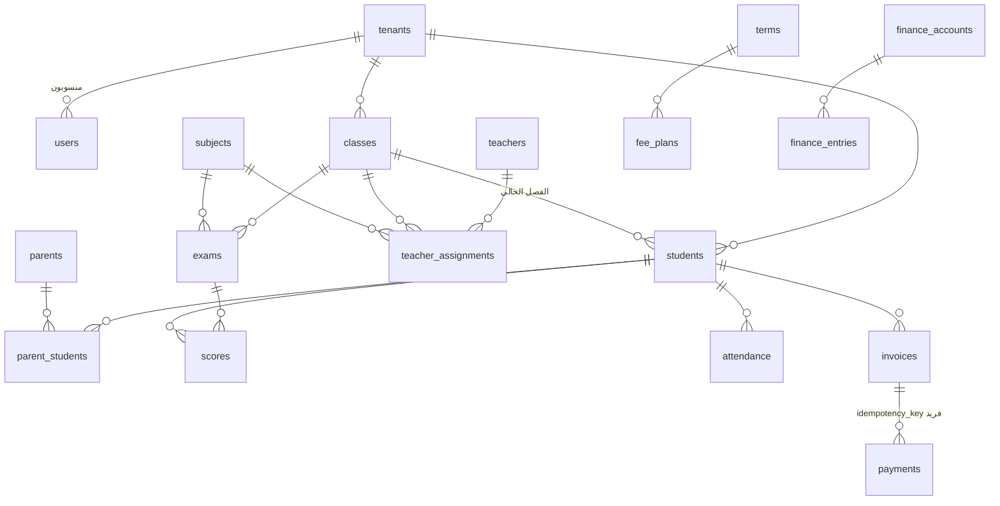

# المرحلة الثانية: تصميم البنية الجديدة

**التاريخ:** 5 نوفمبر 2026
**الحالة:** مسودة للاعتماد. لا يبدأ أي تنفيذ قبل موافقتك على هذا المستند.
**المرجع:** [تقرير المرحلة الأولى](PHASE-1-REPORT.md)

## 0. الأساس الذي بُني عليه التصميم

| القرار | المصدر |
|---|---|
| الخيار (أ): Workers + Hyperdrive + **الإبقاء على PostgreSQL** | توصية المرحلة الأولى، واعتُبر «أبدأ» موافقة عليها. **إن أردت غير ذلك أوقفني قبل المرحلة الثالثة** |
| D1 تُدرس لاحقًا بإثبات مفهوم مستقل (القسم 11) | المرحلة الأولى |
| البناء والاختبار على الخطة المجانية، ولا اشتراك مدفوع دون موافقة | وثيقتك، البند 13 |
| Render وNeon والدومين لا تُمس حتى المرحلة الثامنة | وثيقتك، المرحلة الثامنة |

**مبدأ التصميم الحاكم:** كل حماية موجودة اليوم في قاعدة البيانات تبقى فيها. Cloudflare تضيف طبقات فوقها (الحافة، الملفات، المهام، الحماية من الروبوتات)، ولا تحلّ محلها.

---

## 1. مخطط البنية

```
                    ┌──────────────────────────────────────────────┐
  المتصفح / التطبيق │ Cloudflare: DNS · WAF · Turnstile · Rate Limit │
                    └───────────────┬──────────────────────────────┘
                                    │
        ┌───────────────────────────┼─────────────────────────────┐
        │                           │                             │
  Static Assets              Worker: midar-api               R2 مباشرة
  (الواجهة، مجانية)        (Express عبر httpServerHandler)   (رفع/تنزيل بروابط موقّعة)
                                    │
          ┌──────────────┬──────────┼───────────┬────────────────┐
          │              │          │           │                │
     Hyperdrive         KV         R2       Queues: notify   Rate Limit
          │          (إعدادات   (binding)   Queues: jobs     (binding)
          ▼           مؤقتة)                    │
     PostgreSQL                                 ▼
     (Neon حاليًا)                     Worker: midar-jobs
     RLS · مشغّلات ·                    (المستهلك + Cron)
     قيود · تدقيق                              │
          ▲                                     │
          └──────────── Hyperdrive ─────────────┘
```

### مسار الطلب الواحد
1. Cloudflare تفحص الطلب: قواعد WAF، ثم حد المعدل العام لكل جلسة أو عنوان.
2. الأصول الثابتة تُخدم مباشرة دون تشغيل الـ Worker، فهي مجانية وغير محدودة.
3. طلبات `/api/*` تصل إلى `midar-api`: تحقق الجلسة، ثم الصلاحية، ثم التحقق من المدخلات (zod)، ثم منطق الأعمال.
4. كل وصول لقاعدة البيانات يمر بـ `transaction(ctx, fn)` الحالية دون تغيير في واجهتها: `BEGIN`، ثم `set_config('app.tenant_id', …)`، ثم الاستعلامات، ثم `COMMIT`. **سياسات RLS تعمل كما هي.**
5. العمل غير العاجل يُكتب في جدول صادر (outbox) **داخل المعاملة نفسها**، ثم تُرسل رسالة تنبيه إلى الطابور بعد نجاح المعاملة.

---

## 2. تنظيم الكود

الهدف: **كود واحد يعمل على Node (Render) وعلى Workers في الوقت نفسه** خلال فترة الانتقال، حتى نقارن الاثنين بالاختبارات نفسها، ونرجع إلى Render في أي لحظة دون خسارة.

```
src/
  app.js                     ← بلا تغيير جوهري (Express)
  modules/**                 ← منطق الأعمال: بلا تغيير جوهري
  core/
    platform/                ← جديد: طبقة تجريد بين المنطق والبيئة
      index.js               ← يختار المحوّل حسب البيئة
      node.js                ← المحوّل الحالي: pg Pool، القرص، setInterval
      workers.js             ← المحوّل الجديد: Hyperdrive، R2، Queues، Cron
    storage/                 ← جديد: واجهة الملفات (put/get/sign/delete) فوق R2 أو قاعدة البيانات
    queue/                   ← جديد: واجهة enqueue + تسجيل الحالة
    db/pool.js               ← يُعدَّل: يطلب الاتصال من المحوّل
  server.js                  ← نقطة الدخول على Node (تبقى لـ Render)
workers/
  api.js                     ← نقطة الدخول على Workers: httpServerHandler(createApp())
  jobs.js                    ← مستهلك الطوابير + معالج Cron
wrangler.jsonc               ← البيئات الثلاث، الربط، الحدود
```

**قواعد الفصل:**
- المسارات (`routes`) لا تكتب SQL، بل تستدعي `*.service.js`. هذا مطبق في معظم الكود اليوم، والمخالفات تُصحح أثناء النقل.
- الخدمات لا تعرف هل تعمل على Node أو Workers، بل تستدعي `core/platform` فقط.
- الأخطاء تمر بـ `core/http/errors.js` الحالية: رسالة عربية للمستخدم ورمز ثابت، والتفاصيل الداخلية في السجل فقط.

---

## 3. قاعدة البيانات

### 3.1 القرار: تطوير المخطط الحالي لا استبداله

المخطط الحالي (186 جدولًا) مصمم أصلًا بالمبادئ التي تطلبها وثيقتك. التحقق من كل مبدأ:

| مبدأ في وثيقتك | الوضع الحالي |
|---|---|
| معرّف المدرسة في كل سجل تابع | **164 جدولًا** فيها `tenant_id`. الجداول الـ 22 الباقية جداول منصة عامة (الباقات، أنواع المؤسسات، إعدادات المنصة، أمان المالك، حسابات المستخدمين عبر المدارس) |
| العزل على مستوى الخادم | RLS على 125 جدولًا + دور تطبيق `NOBYPASSRLS` + مفاتيح أجنبية مركّبة `(tenant_id, id)` تمنع ربط سجل بسجل مدرسة أخرى |
| المعاملات | كل وصول عبر `transaction()` |
| عدم تكرار الدفعات | `UNIQUE (tenant_id, idempotency_key)` على `payments`، ومفتاح مماثل على `payment_claims` |
| سجل تدقيق | `audit_log` يُكتب بالمشغّلات على 38 جدولًا، ومحمي من التعديل |
| قيود التحقق | أكثر من 1,000 قيد `CHECK` |
| الفهارس للبيانات الكبيرة | 212 فهرسًا، تبدأ معظمها بـ `tenant_id` |
| المبالغ | `numeric(12,2)` دقيق |

**إعادة التصميم من الصفر هنا تعني إعادة كتابة 29 ألف سطر لنصل إلى المبادئ نفسها.** لذلك التصميم يحدد **تغييرات مستهدفة** على المخطط، تُنفذ بترحيلات جديدة (`0107` فما بعد)، ولا يُعدَّل أي ترحيل قديم.

### 3.2 خريطة المجالات

| المجال | أبرز الجداول |
|---|---|
| المنصة والاشتراكات | `tenants`, `plans`, `plan_features`, `subscriptions`, `subscription_invoices`, `renewal_requests`, `school_activations`, `leads`, `org_types` |
| الهوية والصلاحيات | `users`, `sessions`, `accounts`, `account_schools`, `account_identities`, `staff_recovery`, `owner_security`, `rate_limits` |
| البنية الأكاديمية | `academic_years`, `terms`, `stages`, `grades`, `classes`, `subjects`, `teacher_assignments`, `timetable_slots` |
| الأشخاص | `students`, `student_years`, `parents`, `parent_students`, `teachers`, `staff` |
| الحضور | `attendance`, `attendance_days`, `attendance_events`, `attendance_credentials`, `gates`, `gate_devices`, `staff_attendance` |
| التقييم | `exams`, `scores`, `score_changes`, `grade_components`, `assessments`, `assessment_scores`, `result_batches`, `online_exams`, `online_attempts`, `question_bank` |
| المالية | `fee_plans`, `invoices`, `payments`, `payment_claims`, `fee_adjustments`, `finance_accounts`, `finance_entries`, `finance_categories`, `payroll_runs`, `payroll_items`, `donations` |
| الوثائق | `certificates`, `certificate_templates`, `certificate_serials`, `attachments` |
| التواصل | `notifications`, `notification_deliveries`, `push_subscriptions`, `announcements`, `chat_threads`, `chat_messages`, `sms_messages`, `wa_outbox` |
| السجلات | `audit_log`, `security_events`, `security_alerts`, `jobs` |
| أنواع المؤسسات | المعهد (`programs`, `courses`, `enrollments`)، الجامعة (`uni_*`، 12 جدولًا)، القرآن (`halaqat`, `quran_*`) |

### 3.3 العلاقات الأساسية



كل علاقة بين جدولين تابعين لمدرسة مركّبة من `(tenant_id, id)`، فلا يمكن فيزيائيًا ربط درجة طالب من مدرسة باختبار من مدرسة أخرى.

### 3.4 التغييرات المستهدفة في المخطط

| # | التغيير | السبب |
|---|---|---|
| 1 | جدول **`files`** موحّد للبيانات الوصفية: `tenant_id`، النوع، السجل المرتبط، مفتاح R2، الحجم، النوع الفعلي، بصمة SHA-256، الحالة (`pending`/`ready`/`quarantined`/`deleted`)، من رفعه، ومتى | نقل المحتوى من `bytea` إلى R2، مع بقاء الصلاحية والعزل في قاعدة البيانات (القسم 4) |
| 2 | عمود `file_id` في الجداول السبعة التي تخزن الملفات، وفي صور الطلاب والمعلمين، مع إبقاء `data` مؤقتًا | النقل التدريجي القابل للرجوع، ثم يُحذف `data` في ترحيل لاحق **بعد** مطابقة كل ملف |
| 3 | جدول **`idempotency_keys`** عام: المفتاح، المدرسة، المستخدم، المسار، بصمة الطلب، الاستجابة المحفوظة، مدة الصلاحية | تعميم منع التكرار من الدفعات إلى كل عملية حساسة: رصد الدرجات الجماعي، الحضور الجماعي، الاستيراد، إنشاء الفواتير، اعتماد النتائج |
| 4 | توسيع جدول **`jobs`** بأعمدة: المحاولات، آخر خطأ، موعد المحاولة التالية، النتيجة المشفرة ومدة صلاحيتها | استبدال `Map` في الذاكرة (`core/jobs.js`) بحالة دائمة لا تضيع عند انتهاء الطلب |
| 5 | جدول **`cron_runs`**: اسم المهمة، البداية، النهاية، النتيجة، الخطأ | مراقبة المهام المجدولة، وتشخيص ما لم يعمل دون تخمين |
| 6 | تقسيم الجداول المتنامية زمنيًا (`audit_log`, `security_events`, `attendance_events`, `notification_deliveries`, `sync_changes`) حسب الشهر **عند الحاجة**، بعد قياس أحجامها | يبقي الاستعلامات والحذف الدوري سريعين. لا يُنفذ قبل أن تثبت القياسات الحاجة إليه |

### 3.5 الترقيم والبحث
- القوائم الطويلة (الطلاب، الفواتير، السجلات) تتحول تدريجيًا إلى **ترقيم بالمؤشر** (`WHERE (tenant_id, id) > ($1, $2) ORDER BY id LIMIT n`) بدل `OFFSET`، فيبقى زمنها ثابتًا مهما كبرت البيانات.
- البحث بالاسم يستخدم اليوم `ILIKE` (53 موضعًا). عند تجاوز المدرسة بضعة آلاف من السجلات يُضاف فهرس `pg_trgm`، **بعد قياس** الحاجة في المرحلة السادسة.

### 3.6 استراتيجية التوسع في قاعدة البيانات

| المرحلة | متى | الإجراء |
|---|---|---|
| 1 | الآن | قاعدة واحدة، Hyperdrive للاتصالات، فهارس مقيسة |
| 2 | عند ضغط القراءة | نسخة قراءة (read replica) للتقارير والتحليلات |
| 3 | عند كبر الجداول الزمنية | التقسيم الشهري (البند 6 أعلاه) |
| 4 | آلاف المدارس | **تقسيم المدارس على عدة قواعد** حسب `tenant_id`، عبر جدول توجيه صغير. التصميم الحالي جاهز لذلك، لأن كل بيانات المدرسة مربوطة بـ `tenant_id` ولا توجد علاقات بين المدارس |

---

## 4. تخزين الملفات في R2

### 4.1 الحاويات

| الحاوية | المحتوى | الوصول العام |
|---|---|---|
| `midar-files-<env>` | كل ملفات المدارس | **مغلقة**، لا رابط عام، ولا نطاق `r2.dev` |
| `midar-public-<env>` | ما هو عام بطبيعته فقط: شعار المدرسة في صفحتها العامة، صور الموقع التعريفي | قراءة عامة عبر نطاق مخصص |
| `midar-backups-<env>` | النسخ الاحتياطية المشفّرة لقاعدة البيانات والملفات | مغلقة، ويوصى بقفل الكائنات |

البيئات: `dev` و`staging` و`prod`، **كل بيئة بحاوياتها المستقلة**، فلا يمكن لبيئة الاختبار أن تمس ملفات الإنتاج.

### 4.2 تسمية المفاتيح

```
t/<tenant_id>/<kind>/<record_id>/<uuid>.<ext>
مثال: t/alnoor/student-photo/1532/5f0c…e1.webp
```

- لا يُستخدم اسم الملف الأصلي في المفتاح أبدًا. يُحفظ في جدول `files` للعرض فقط، بعد تنظيفه.
- المفتاح يبدأ بمعرّف المدرسة، فيمكن نسخ ملفات مدرسة أو حذفها أو استعادتها وحدها.

### 4.3 الرفع (دون تحميل الملف على الـ Worker)

```
1. الواجهة ← POST /api/files/upload-intent {kind, record_id, size, type, sha256}
2. الخادم:  يتحقق من الجلسة والصلاحية وأن السجل للمدرسة نفسها،
            ومن النوع والحجم المسموح لهذا النوع، ومن حصة المدرسة،
            ثم ينشئ صفًا في files بحالة pending،
            ويعيد رابط PUT موقّعًا صالحًا 5 دقائق ومقيّدًا بنوع المحتوى
3. المتصفح ← PUT مباشرة إلى R2
4. الواجهة ← POST /api/files/:id/complete
5. الخادم:  يقرأ أول بايتات الملف من R2 ليتحقق من نوعه الفعلي (لا من الامتداد)،
            ويطابق الحجم والبصمة، ثم يحوّل الحالة إلى ready،
            أو quarantined ويحذف الكائن إن لم يطابق
```

ملفات بقيت `pending` أكثر من 24 ساعة تحذفها قاعدة دورة حياة في R2 ومهمة تنظيف مجدولة.

الحدود الحالية تبقى كما هي: الصور الشخصية 150 كيلوبايت، المرفقات المالية 2 ميغابايت، أصول الشهادات 3 ميغابايت، وسائط الاختبارات 10 ميغابايت.

### 4.4 التنزيل
- **الافتراضي:** الـ Worker يتحقق من الصلاحية ثم يمرر الملف من R2 عبر الربط المباشر، فلا يُكشف أي رابط.
- **الملفات الكبيرة** (الصوت والفيديو والتقارير): رابط GET موقّع صالح 5 دقائق، يُصدر **بعد** التحقق من الصلاحية.
- كل تنزيل لملف حساس (المرفقات المالية، النسخ الاحتياطية) يُسجل في `audit_log`.

### 4.5 الاحتفاظ والحذف

| النوع | الاحتفاظ |
|---|---|
| صور الطلاب والمعلمين | ما دام السجل موجودًا، وتُحذف مع حذفه |
| المرفقات المالية والإيصالات | لا تُحذف إلا مع حذف المدرسة كلها، لأنها سجل مالي |
| ملفات إجابات الاختبارات الإلكترونية | حتى نهاية السنة الدراسية التالية |
| التقارير والتصديرات المولّدة | 7 أيام (يمكن توليدها من جديد) |
| نسخ المدرسة قبل عمليات «منطقة الحذر» | 30 يومًا، كما هي اليوم |

الحذف «ناعم» أولًا (`deleted_at`)، ثم فعلي من R2 بعد 30 يومًا بمهمة مجدولة. بذلك يمكن التراجع عن حذف خاطئ.

### 4.6 نقل الملفات الحالية من قاعدة البيانات إلى R2
1. مهمة تقرأ كل ملف، وترفعه إلى R2، وتحسب بصمة SHA-256، وتسجل `file_id`.
2. القراءة تتحول إلى R2 **فقط** للملفات التي طابقت بصمتها.
3. بعد أسبوعين دون أخطاء، وبعد موافقتك، يُحذف عمود `data` بترحيل منفصل.

---

## 5. المهام الخلفية والإشعارات

### 5.1 المبدأ: قاعدة البيانات مصدر الحقيقة، والطابور جرس تنبيه

المنصة تملك اليوم نظام تسليم ناضجًا (`notification_deliveries`): حالات `pending`، `processing`، `sent`، `retrying`، `failed`، ومحاولات بتأخير متصاعد حتى 6 مرات، وأقفال `FOR UPDATE SKIP LOCKED` تمنع المعالجة المزدوجة. **نحتفظ به كما هو.**

الطابور لا يحمل محتوى الرسالة، بل تنبيهًا مختصرًا: «توجد مهام للمدرسة X». لذلك:
- **لا تضيع مهمة** حتى لو ضاعت رسالة الطابور أو انتهت مدتها: الحالة في قاعدة البيانات، وCron يمسح المتأخر كل دقيقة.
- **لا تتكرر مهمة**: الانتقال `pending → processing` يحدث داخل معاملة بقفل، ولا يأخذ المهمة إلا عامل واحد.
- **يكفي الحد المجاني:** رسالة طابور واحدة تُطلق دفعة كاملة حتى 200 تسليم، بدل رسالة لكل تسليم.

### 5.2 الطوابير

| الطابور | المحتوى | الإعدادات |
|---|---|---|
| `midar-notify-<env>` | `{tenant_id}` | دفعة حتى 10 رسائل، 5 محاولات، تأخير المحاولة 30 ثانية، DLQ |
| `midar-jobs-<env>` | `{job_id}` للاستيراد والتصدير والتقارير وPDF والعمليات الجماعية | دفعة رسالة واحدة، 3 محاولات، DLQ |
| `midar-dlq-<env>` | الرسائل التي فشلت كل محاولاتها | تُعرض في لوحة المالك، وتنبيه عند وصول أي رسالة |

المهمة الطويلة (استيراد آلاف الطلاب) تُقسم إلى دفعات، وكل دفعة تحفظ تقدمها في جدول `jobs`. لو توقف الـ Worker تستكمل المحاولة التالية من آخر دفعة ناجحة.

### 5.3 المهام المجدولة

الخطة المجانية تسمح بـ 5 مشغّلات Cron للحساب كله، فنستخدم **مشغّلًا واحدًا كل دقيقة** يوزع العمل:

| المهمة | التكرار (كما هو اليوم) |
|---|---|
| مسح التسليمات المتأخرة والمحاولات | كل دقيقة |
| إشعارات المالك | كل دقيقة |
| البوابة الذكية + تنبيهات الأمان بالبريد | كل 5 دقائق |
| الصيانة (حذف الجلسات المنتهية) + التذكيرات | كل ساعة |
| مراقبة استهلاك قاعدة البيانات | كل 3 ساعات |
| تنظيف الملفات المعلّقة والمحذوفة | يوميًا |

كل تشغيل يُسجل في `cron_runs`. إذا فشلت مهمة 3 مرات متتالية، أو لم تعمل في موعدها، يصل تنبيه إلى المالك.

---

## 6. الأمان

| الطبقة | التصميم |
|---|---|
| HTTPS | إلزامي على كل الطلبات، مع HSTS |
| كلمات المرور | scrypt بالإعدادات الحالية (N=2^15)، **دون إضعاف** |
| الجلسات | كما هي: ملف تعريف ارتباط `HttpOnly` و`Secure` و`SameSite` لكل دور، والرمز مجزّأ في قاعدة البيانات، ومهلة خمول ومدة قصوى |
| التحقق الثنائي | TOTP للمالك (قائم). **مقترح:** إتاحته اختياريًا لمديري المدارس والمحاسبين |
| CSRF | فحص `Origin` و`Sec-Fetch-Site` القائم في `sameOrigin()` يبقى |
| الصلاحيات | تُفحص في الخادم لكل طلب (قائم)، ومصفوفة العزل تختبر كل مسار تلقائيًا |
| حدود المعدل | **طبقتان:** (1) Rate Limiting من Cloudflare للحدود العامة، تقريبية ولكل موقع، مجانية. (2) حدود الدخول والدفع في قاعدة البيانات كما هي، دقيقة ومشتركة |
| الروبوتات | Turnstile على: طلب التجربة، طلبات التسجيل العامة، استعادة كلمة المرور، والدخول بعد 3 محاولات فاشلة |
| WAF | القواعد المُدارة المجانية + قاعدة حد معدل واحدة على مسارات الدخول. **يتطلب نقل الدومين إلى Cloudflare، ولا يحدث دون موافقتك** |
| CORS | لا CORS على `/api`، فالواجهة من النطاق نفسه. حاوية R2 تسمح بـ `PUT` و`GET` من نطاق المنصة فقط |
| SSRF | `safe-url.js` يُعاد تصميمه: قائمة نطاقات مسموحة لكل تكامل (بوابة الرسائل، البريد) بدل فحص DNS |
| السجلات | لا تُسجل كلمات مرور ولا رموز ولا أرقام هواتف كاملة. يوجد اختبار يتحقق من ذلك اليوم (`danger-zone.test.js`)، ويُعمم |
| الاعتماديات | `npm audit` في كل تشغيل للاختبارات، ومراجعة دورية |

---

## 7. البيئات والأسرار

| البيئة | الـ Workers | قاعدة البيانات | R2 / Queues / KV |
|---|---|---|---|
| **التطوير** | `wrangler dev` على الجهاز | PostgreSQL محلية | محاكاة محلية (Miniflare) |
| **الاختبار** (staging) | `midar-api-staging` على `workers.dev` | **فرع من Neon** (نسخة من الإنتاج دون التأثير عليه)، أو قاعدة اختبار مستقلة ببيانات تجريبية | موارد `-staging` مستقلة |
| **الإنتاج** | `midar-api` | Neon الحالية | موارد `-prod` |

**لا يُجرّب أي تعديل على الإنتاج.** كل تغيير يمر: فرع ثم اختبارات آلية ثم staging ثم مراجعة ثم الإنتاج.

### الأسرار
كل الأسرار تُضاف بـ `wrangler secret put` لكل بيئة على حدة، ولا تُكتب في المستودع ولا في `wrangler.jsonc`:

`OWNER_PASSWORD_HASH`, `OWNER_TOTP_SECRET`, `CREDENTIAL_KEY`, `VAPID_PRIVATE_KEY`, `ANTHROPIC_API_KEY`, `NEON_API_KEY`, `R2_ACCESS_KEY_ID`, `R2_SECRET_ACCESS_KEY` (لتوقيع الروابط فقط، بصلاحية حاوية واحدة)، `TURNSTILE_SECRET`. أما رابط قاعدة البيانات فيُدار داخل إعداد Hyperdrive نفسه.

**التدوير:** كل سر له إجراء موثق للتغيير دون توقف. `CREDENTIAL_KEY` يدعم مفتاحين (قديم وجديد) خلال فترة إعادة التشفير.

---

## 8. النسخ الاحتياطي والاستعادة

الخطة الحالية (`docs/DISASTER_RECOVERY.md`) قوية لقاعدة البيانات، وتُستكمل للملفات:

| الطبقة | ما يُنسخ | التكرار | الاحتفاظ | التشفير |
|---|---|---|---|---|
| 1. الاسترجاع لأي لحظة في Neon | قاعدة البيانات | مستمر | حسب خطة Neon (يُتحقق منها) | من Neon |
| 2. نسخة يومية مستقلة (`backup.yml`، قائمة) | `pg_dump` كامل | يوميًا | 35 يومًا / 120 / 400 | AES-256 |
| 3. نسخة خارجية | الملف المشفّر نفسه إلى `midar-backups-prod` في R2 | يوميًا | مطابق للطبقة 2، مع قفل الكائنات | AES-256 |
| 4. **جديد: ملفات R2** | نسخ يومي تزايدي من `midar-files-prod` إلى `midar-backups-prod/files/` | يوميًا | 35 يومًا للمحذوف | تشفير R2 + تشفير مستقل لملفات المال والهوية |
| 5. **جديد: نسخة خارج Cloudflare** | الطبقتان 2 و4 إلى مزود ثانٍ (حساب منفصل) | أسبوعيًا | 120 يومًا | AES-256 |

### الأهداف

| | الهدف | الشرط |
|---|---|---|
| **RPO** لحوادث داخل قاعدة البيانات (حذف أو خطأ بشري) | 15 دقيقة | خطة Neon بنافذة استرجاع 7 أيام على الأقل |
| **RPO** عند فقد حساب Neon بالكامل | 24 ساعة | نجاح النسخة اليومية |
| **RPO** للملفات | 24 ساعة | نجاح النسخ اليومي لـ R2 |
| **RTO** استرجاع داخل Neon | ساعة واحدة | إجراء موثق ومجرّب |
| **RTO** إعادة بناء كاملة من النسخ المستقلة | 4 ساعات | تجربة استعادة ناجحة خلال آخر 30 يومًا |

### اختبار الاستعادة (لا تُعد النسخة ناجحة دونه)
- **آليًا كل أسبوع** (`backup-verify.yml` قائم، ويُوسّع): تُستعاد آخر نسخة في قاعدة مؤقتة، وتُطابق أعداد الصفوف لكل جدول وبصمات عينة من الملفات، ثم تُحذف القاعدة المؤقتة. الفشل يرسل تنبيهًا.
- **يدويًا كل شهر:** تمرين استعادة كاملة في بيئة staging، مع قياس الوقت الفعلي مقارنة بالـ RTO وتوثيق النتيجة.

---

## 9. المراقبة

| ما يُراقب | الأداة | التنبيه |
|---|---|---|
| أخطاء التطبيق وفشل API | Workers Logs (المجانية: 200 ألف حدث يوميًا لمدة 3 أيام) بسجلات منظمة: معرّف الطلب، المدرسة، المسار، المدة، الرمز | معدل أخطاء 5xx فوق 1% لمدة 5 دقائق |
| أخطاء قاعدة البيانات وبطؤها | `core/perf.js` القائم + مقاييس Hyperdrive | استعلام فوق ثانيتين، فشل الاتصال |
| المهام الخلفية | جدولا `jobs` و`cron_runs` + طول الطابور (`queue.metrics()`) + DLQ | أي رسالة في DLQ، أو طابور أقدم من 10 دقائق، أو Cron لم يعمل |
| الدخول الفاشل والوصول غير المصرح | `security_events` القائم | تنبيه المالك القائم (`alerts.service.js`) |
| الاستهلاك والتكلفة | لوحة Cloudflare + تنبيهات الميزانية + مراقبة Neon القائمة | 80% من أي حد مجاني أو ميزانية |
| النسخ الاحتياطي | GitHub Actions القائمة + فحص عمر آخر نسخة | نسخة أقدم من 48 ساعة، أو فشل تجربة الاستعادة |

كل طلب يحمل `request_id` يظهر في رسالة الخطأ للمستخدم («رقم المرجع: …»)، فنجد سجله مباشرة دون تخمين.

---

## 10. خطة الانتقال والرجوع

1. **المرحلة الثالثة:** نشر المنصة كاملة على `midar-api-staging` (نطاق `workers.dev`) متصلة بقاعدة اختبار. Render والإنتاج لم يُمسّا.
2. **التحقق:** تشغيل **كل** الاختبارات الحالية (69 ملفًا) على النسختين، Node وWorkers، ويجب أن تتطابق النتائج.
3. **الأحمال والأمان والاستعادة** (المرحلة السادسة) على staging.
4. **الانتقال الرسمي** (المرحلة الثامنة، بموافقتك فقط): تبديل DNS إلى Workers. **Render يبقى يعمل** على القاعدة نفسها.
5. **الرجوع:** إن ظهرت مشكلة، يعاد DNS إلى Render خلال دقائق، ولا تضيع أي بيانات لأن قاعدة البيانات واحدة.
6. بعد 30 يومًا مستقرًا وبموافقتك: يُوقف Render.

---

## 11. إثبات مفهوم D1 (اختياري، لاحقًا)

لتقييم D1 تقييمًا عادلًا قبل أي قرار نهائي:
- **النطاق:** وحدة واحدة معزولة، كالحضور، على تصميم **قاعدة D1 لكل مدرسة**.
- **الأسئلة التي يجيب عنها:** زمن ذروة الحضور الصباحي، تكلفة الصفوف المكتوبة الفعلية مع الفهارس والتدقيق، تعقيد الترحيلات على مئات القواعد، النسخ والاستعادة لكل مدرسة.
- **المعيار:** يُعتمد D1 لوحدة ما فقط إذا تفوق في الأداء أو التكلفة **دون** نقل أي حماية من قاعدة البيانات إلى الكود.

---

## 12. القرارات المطلوبة منك

1. **اعتماد هذا التصميم** للانتقال إلى المرحلة الثالثة (إنشاء بيئة staging على الخطة المجانية).
2. **قاعدة اختبار staging:** فرع من Neon (يتطلب أن أعرف خطتك في Neon؛ الفروع متاحة على المجانية بحدود)، أم قاعدة تجريبية ببيانات وهمية فقط؟ **أوصي بالبيانات الوهمية أولًا**، حتى لا تخرج بيانات مدارس حقيقية إلى بيئة اختبار.
3. **R2 غير مفعّل في حسابك** (رفضت Cloudflare طلبي وطلبت تفعيله من اللوحة). التفعيل خطوة في الحساب نفسه، وقد تُطلب فيها بيانات فوترة، لذلك **التفعيل يجب أن يكون منك**. لن أفعّله.
4. **الدومين ومزود البريد:** أحتاجهما للتخطيط فقط، دون أي تغيير.
